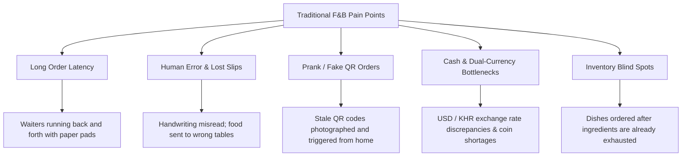
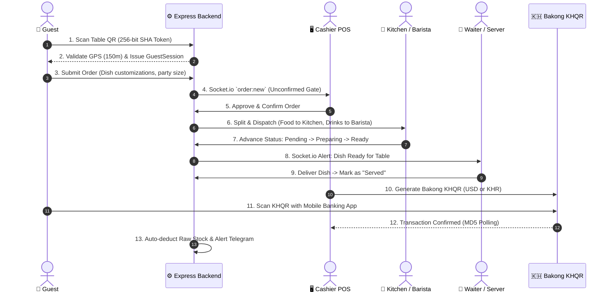
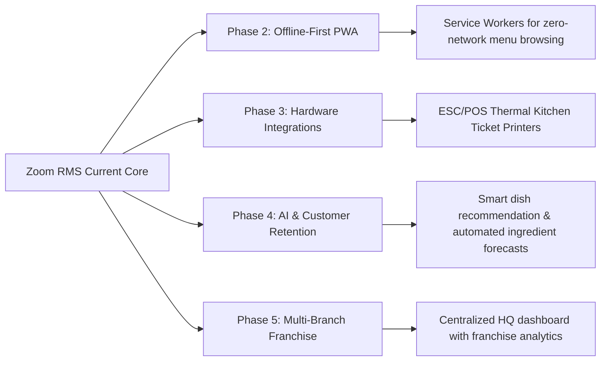

# Zoom RMS — Executive Presentation Deck
## *Smart Restaurant Management System for Modern Cafes & Dining*

---

```
  ____                             ____   __  __  ____  
 |__  /  ___    ___   _ __ ___    |  _ \ |  \/  |/ ___| 
   / /  / _ \  / _ \ | '_ ` _ \   | |_) || |\/| |\___ \ 
  / /_ | (_) || (_) || | | | | |  |  _ < | |  | | ___) |
 /____| \___/  \___/ |_| |_| |_|  |_| \_\|_|  |_||____/ 
                                                        
     Garden Café & Wine • Next-Gen Digital Dining Experience
```

> **Target Audience:** Academic Defense Committee, Thesis Jury, Restaurant Owners & Technical Stakeholders  
> **Repository:** `neang214/zoom-rms`  
> **Tech Stack:** React 19 • Express 5 • Prisma ORM • PostgreSQL (Neon) • Socket.io • Bakong KHQR • Telegram API  
> **Estimated Presentation Time:** 15 – 20 Minutes (Slides + Live Demo)

---

## Slide Navigation Table

| Slide # | Slide Title | Primary Theme |
| :---: | :--- | :--- |
| **01** | [Title & Project Identity](#slide-01-title--project-identity) | Project Overview & Branding |
| **02** | [Industry Problem Statement](#slide-02-industry-problem-statement) | Challenges in Traditional F&B Operations |
| **03** | [The Zoom RMS Solution](#slide-03-the-zoom-rms-solution) | Holistic Full-Stack Vision |
| **04** | [High-Level Architecture & Tech Stack](#slide-04-high-level-architecture--tech-stack) | Modern Engineering Ecosystem |
| **05** | [End-to-End System Workflow](#slide-05-end-to-end-system-workflow) | Real-Time Order Lifecycle Diagram |
| **06** | [Multi-Tier Anti-Prank & Security Shield](#slide-06-multi-tier-anti-prank--security-shield) | Cryptographic QR, Geofencing & Advisory Locks |
| **07** | [Guest Self-Ordering Web Portal](#slide-07-guest-self-ordering-web-portal) | Frictionless Mobile Customer Journey |
| **08** | [Cashier POS & Anti-Ghost Confirmation Gate](#slide-08-cashier-pos--anti-ghost-confirmation-gate) | Floor Management & Order Verification |
| **09** | [Dedicated Station Queues: KDS & BDS](#slide-09-dedicated-station-queues-kds--bds) | Split Kitchen & Barista Display Systems |
| **10** | [Waiter & Server Mobility Module](#slide-10-waiter--server-mobility-module) | Tableside Service & Delivery Confirmation |
| **11** | [National Payment Gateway: Bakong KHQR](#slide-11-national-payment-gateway-bakong-khqr) | NBC Digital Currency Integration (USD & KHR) |
| **12** | [Inventory, Purchase Orders & Telegram Bot](#slide-12-inventory-purchase-orders--telegram-bot) | Automated Supply Chain & Real-Time Alerts |
| **13** | [Business Intelligence & Reporting](#slide-13-business-intelligence--reporting) | Revenue Analytics & Peak-Hour Traffic |
| **14** | [Modular Cost Breakdown & Economics](#slide-14-modular-cost-breakdown--economics) | 22-Module Scope Analysis ($1,350) |
| **15** | [Live Demonstration Protocol](#slide-15-live-demonstration-protocol) | Step-by-Step Scenario Walkthrough |
| **16** | [Strategic Roadmap & Extensibility](#slide-16-strategic-roadmap--extensibility) | Scalability, PWA, Multi-Branch Expansion |
| **17** | [Conclusion & Academic Summary](#slide-17-conclusion--academic-summary) | Key Achievements & Q&A Transition |

---

## Slide 01: Title & Project Identity

### 📌 Title: Zoom RMS — Restaurant Management System
**Subtitle:** A Modern, Full-Stack, Real-Time Digital Operating System for Cafes & Fine Dining

```
+-------------------------------------------------------------------------------+
|                                ZOOM RMS                                       |
|                  Smart Hospitality Digital Ecosystem                          |
|                                                                               |
|  [Guest Mobile QR]  -->  [Cashier POS Gate]  -->  [Kitchen & Barista Queues]   |
|         |                                                   |                 |
|         +----------------- [Bakong KHQR Payments] <---------+                 |
+-------------------------------------------------------------------------------+
```

#### Key Highlights
- **Target Venue:** Zoom Garden Café & Wine (High-turnover dining, cafe & beverage service).
- **Core Value:** Eliminates wait times, eradicates order confusion, automates inventory tracking, and brings modern cashless payment to Cambodia's dining industry.
- **Delivery Format:** Responsive Web App for Guests + Role-based Staff Application (Desktop POS & Mobile Handhelds).

#### 🗣️ Speaker Notes / Voice Script
> *"Good morning, respected members of the evaluation committee and distinguished guests. Today, I am proud to present Zoom RMS — an end-to-end, real-time Restaurant Management System designed from the ground up for modern dining venues. Inspired by the operational realities of Zoom Garden Café & Wine, this platform bridges the gap between customer convenience and kitchen efficiency through cryptographic QR guest ordering, real-time WebSocket queues, Bakong KHQR national digital payments, and automated inventory intelligence."*

---

## Slide 02: Industry Problem Statement

### 📌 Title: The Pain Points of Traditional Restaurant Operations



#### Detailed Breakdown
1. **Wait Time Bottlenecks:** During peak hours, customers wait 10–15 minutes just to receive a physical menu and place an order.
2. **Order Miscommunication:** Verbal orders and paper kitchen tickets lead to misplaced requests, forgotten allergies, and dish waste.
3. **The "QR Prank Order" Risk:** Naive QR ordering systems allow anyone who took a photo of a QR code to order food from home, causing massive restaurant losses.
4. **Dual-Currency Friction:** In Cambodia, managing mixed cash transactions in USD and Khmer Riel (KHR) slows down cashier checkout lines and increases accounting errors.
5. **Disconnected Inventory:** Chefs run out of coffee beans or meat mid-shift with no real-time warning sent to front-of-house staff or management.

#### 🗣️ Speaker Notes / Voice Script
> *"In the restaurant business, every lost minute during lunch or dinner rush translates directly to lost revenue and frustrated guests. Traditional operations face five major hurdles: long order turnaround, illegible paper slips, payment delays when calculating USD to Khmer Riel cash change, and unexpected stock depletion. Crucially, when restaurants attempt self-ordering via simple QR codes, they often fall victim to prank orders submitted remotely. Zoom RMS was engineered specifically to solve every single one of these operational vulnerabilities."*

---

## Slide 03: The Zoom RMS Solution

### 📌 Title: An Integrated Real-Time Digital Operating System

```
                  +-----------------------------------+
                  |      ZOOM RMS SOLUTION PILLARS     |
                  +-----------------------------------+
                                    |
     +-----------------+------------+------------+-----------------+
     |                 |                         |                 |
     v                 v                         v                 v
[Contactless QR]  [Anti-Prank Guard]       [Dual Display KDS/BDS] [Bakong KHQR]
Scan to order     GPS Haversine (150m)     Smart food/drink split  Dynamic USD/KHR
Dual language     256-bit Token Hash       Real-time audio chime   Auto-confirm
Custom dish notes Cashier Approval Gate    Direct server alerts    Zero cash delay
```

#### Core Capabilities
- **Frictionless Guest Experience:** Guests scan a table QR code and immediately order on their own mobile browser without installing any mobile app.
- **Ironclad Anti-Prank Security:** Geofencing distance checks (150m radius) + 256-bit cryptographic tokens + Cashier confirmation gate prevent unauthorized or remote ordering.
- **Smart Separation of Concerns:** Food items route automatically to the **Kitchen Display System (KDS)**, while drinks route to the **Barista Display System (BDS)**.
- **Waiter Runner Dispatch:** Once a dish or beverage is marked `Ready`, the handheld Waiter interface is instantly alerted to deliver it to the specific table number.
- **National Bank of Cambodia (NBC) KHQR:** Instant digital payment in USD and KHR with automated verification.

#### 🗣️ Speaker Notes / Voice Script
> *"Zoom RMS solves these challenges not through disconnected third-party tools, but with a unified digital ecosystem. Guests order directly from their smartphones in their preferred language — Khmer or English. The kitchen sees only food tickets, the barista sees only beverage tickets, and the waiter receives an instant alert the exact second an item is plated. Underpinning the entire workflow is our multi-tier anti-prank shield and native Bakong KHQR payment processing."*

---

## Slide 04: High-Level Architecture & Tech Stack

### 📌 Title: Enterprise Full-Stack Engineering Architecture

```
+------------------------------------------------------------------------------------+
|                                FRONTEND ARCHITECTURE                               |
|   React 19 (SPA)  •  Vite 8  •  Tailwind CSS v4  •  Radix UI  •  Zustand / Context  |
|   Role Gating: [Guest Portal] [Cashier POS] [Kitchen KDS] [Barista BDS] [Waiter]   |
+------------------------------------------------------------------------------------+
                                         ▲
                                         │  HTTPS REST API + WSS (Socket.io)
                                         ▼
+------------------------------------------------------------------------------------+
|                                BACKEND ARCHITECTURE                                |
|   Node.js (ES Modules)  •  Express 5  •  Prisma ORM 6  •  Socket.io WebSocket Hub  |
|   Security: JWT HTTP-Only Cookies • Bcrypt • Google reCAPTCHA v3 • Haversine Geo   |
+------------------------------------------------------------------------------------+
                                         ▲
                                         │  Connection Pooling + Advisory Locks
                                         ▼
+------------------------------------------------------------------------------------+
|                           DATABASE & CLOUD INFRASTRUCTURE                          |
|   PostgreSQL on Neon Serverless  •  Fly.io Docker Container  •  Telegram Bot API   |
+------------------------------------------------------------------------------------+
```

#### Technology Stack Breakdown

| Layer | Technologies Selected | Strategic Engineering Rationale |
| :--- | :--- | :--- |
| **Frontend Framework** | **React 19 + Vite 8** | Ultra-fast HMR, concurrent rendering, and zero client-side lag. |
| **Styling & UI Design** | **Tailwind CSS v4 + Radix UI** | Modern design system, accessible dialogs, and native dark/light modes. |
| **State & Networking** | **Zustand + Axios + Socket.io-client** | Lightweight global stores and synchronized real-time event updates. |
| **Backend Framework** | **Express 5 on Node.js (ESM)** | Modern async promise handling, native middleware pipelining. |
| **Database & ORM** | **PostgreSQL (Neon) + Prisma ORM 6** | Type-safe schema, relational integrity, serverless auto-scaling. |
| **Transactions & Locks**| **Postgres Advisory Locks** | `pg_advisory_xact_lock` prevents concurrent race conditions on tables. |
| **Payments & Integrations**| **Bakong KHQR + Telegram Bot API** | Official NBC digital standard + Instant manager mobile alerts. |

#### 🗣️ Speaker Notes / Voice Script
> *"From an engineering perspective, our stack is built for speed, safety, and scalability. On the client side, we use React 19 paired with Vite 8 and Tailwind CSS v4 to deliver a polished 60-FPS interface. On the server side, Node.js running Express 5 and Prisma ORM 6 manages clean domain-driven REST endpoints. Real-time bi-directional messaging is handled through Socket.io rooms, backed by serverless PostgreSQL on Neon with transactional advisory locks to eliminate race conditions."*

---

## Slide 05: End-to-End System Workflow

### 📌 Title: Complete Lifecycle of an Order: From Scan to Settlement



#### Step-by-Step Flow Highlights
1. **Verification:** Guest scans QR token; server validates GPS location within 150m of café coordinates.
2. **Session Creation:** A temporary 2-hour hashed session is created in `guest_sessions`.
3. **Anti-Ghost Order Gate:** The order appears on the Cashier's screen as unconfirmed; kitchen/barista are not alerted until cashier approves.
4. **Intelligent Routing:** Food dishes appear on KDS; beverages appear on BDS with audio chime alerts.
5. **Table Runner Notification:** When items are marked `Ready`, servers get a delivery prompt.
6. **Settlement:** Cashier triggers dynamic KHQR or cash payment; upon completion, table availability resets.

#### 🗣️ Speaker Notes / Voice Script
> *"This sequence diagram illustrates the lifecycle of every order in Zoom RMS. Notice the deliberate separation between order placement and kitchen dispatch. When a guest submits an order, it first hits our Cashier Approval Gate. Once the cashier glances at the table and confirms real patrons are seated, the system splits the ticket: steak and pasta to the chef, iced latte and wine to the barista. When ready, the waiter is dispatched, and checkout is completed through digital Bakong KHQR."*

---

## Slide 06: Multi-Tier Anti-Prank & Security Shield

### 📌 Title: 4-Layer Defense Against Malicious & Ghost Orders

```
========================================================================================
                          ZOOM RMS 4-LAYER SECURITY SHIELD
========================================================================================

 [LAYER 1: CRYPTOGRAPHIC QR]    --> 256-bit unguessable SHA token per table.
                                    No predictable IDs (?table=1 is impossible).
                                    
 [LAYER 2: GPS GEOFENCING]      --> Haversine distance formula: client GPS checked
                                    against Cafe Lat/Long. Orders blocked if > 150m.
                                    
 [LAYER 3: GUEST SESSION HASH]  --> Raw session token kept in memory; only SHA-256
                                    hash stored in DB. Expiring 2-hour TTL.
                                    
 [LAYER 4: CASHIER GATE & LOCK] --> Cashier must click Confirm before KDS receives tickets.
                                    `pg_advisory_xact_lock` prevents duplicate tables.
========================================================================================
```

#### Code Implementation Evidence
- **Haversine Geofencing Formula (`backend/src/utils/geo.js`):**
  $$\text{distance} = 2R \cdot \arcsin\left(\sqrt{\sin^2\left(\frac{\Delta\text{lat}}{2}\right) + \cos(\text{lat}_1)\cos(\text{lat}_2)\sin^2\left(\frac{\Delta\text{lon}}{2}\right)}\right)$$
  Orders are rejected with `HTTP 403: "You must be at the café to place an order."`
- **Postgres Advisory Lock (`backend/src/modules/orders/order.controller.js`):**
  ```javascript
  await tx.$executeRaw`SELECT pg_advisory_xact_lock(${table.table_id})`;
  ```
  Guarantees that even if two customers or staff submit orders at the exact same millisecond, only one active order can ever exist per table.

#### 🗣️ Speaker Notes / Voice Script
> *"One of the greatest innovations in Zoom RMS is our 4-layer Anti-Prank Shield. In many restaurants, malicious actors take a photo of a table's QR code and submit fake orders from home to waste food. We stop this completely: First, QR codes contain random 256-bit cryptographic tokens. Second, the backend checks client GPS coordinates via the Haversine formula and rejects any order placed further than 150 meters away. Third, guest sessions expire after 2 hours. And fourth, the cashier maintains final approval authority before any ticket reaches the kitchen."*

---

## Slide 07: Guest Self-Ordering Web Portal

### 📌 Title: Mobile-Optimized Self-Service Customer Journey

```
+-----------------------------------------------------------+
| 📱 GUEST SMARTPHONE DISPLAY                               |
|-----------------------------------------------------------|
| Zoom Garden Café & Wine                     [ 🇰🇭 / 🇬🇧 ]   |
| Table #04 • 4 Guests                                      |
| [ All ] [ ☕ Coffee ] [ 🍝 Food ] [ 🍷 Wine ] [ 🍰 Dessert ]|
|-----------------------------------------------------------|
| +-------------------------------------------------------+ |
| | [ Dish Photo ]  Iced Caramel Macchiato         $3.50  | |
| |                 ការ៉ាមែល ម៉ាគីអាតូកក                  | |
| |                 [Customize: Less Ice, 50% Sweet]     | |
| |                 [ - 1 + ]  [ Add to Cart ]            | |
| +-------------------------------------------------------+ |
|-----------------------------------------------------------|
| 🛒 Cart (2 items) • Total: $8.50                          |
| [ Table Note: "Birthday Celebration" ]                    |
| [ PLACE ORDER NOW ]                                       |
+-----------------------------------------------------------+
```

#### Key Functional Features
- **Zero App Installation:** Runs instantly in any standard browser (Safari, Chrome, Samsung Internet).
- **Instant Bilingual Switching:** One-tap toggle between **Khmer (ភាសាខ្មែរ)** and **English** with full localized descriptions.
- **Granular Customization:** Per-item notes (`"no ice"`, `"extra spicy"`, `"dairy allergy"`) distinct from table-wide notes.
- **Real-Time Live Status Tracking:** Guest phone updates in real time as items transition from `Pending` → `Preparing` → `Served`.

#### 🗣️ Speaker Notes / Voice Script
> *"Here we see the guest mobile interface. It is lightweight, visually appetizing, and requires no app downloads. Guests browse high-definition dish cards, read titles in both Khmer and English, and customize individual items — such as requesting oat milk or less ice. Once submitted, guests can track their order status in real time right from their seats, significantly enhancing customer satisfaction."*

---

## Slide 08: Cashier POS & Anti-Ghost Confirmation Gate

### 📌 Title: Central Floor Control & Order Validation Hub

```
+------------------------------------------------------------------------------------+
| 🖥️ CASHIER POS & FLOOR MANAGEMENT CONSOLE                                          |
|------------------------------------------------------------------------------------|
|  TABLE FLOOR MAP:                                                                  |
|  [ Table 1 : OCCUPIED ]   [ Table 2 : AVAILABLE ]   [ Table 3 : BILL PRINTED ]     |
|  [ Table 4 : PENDING ⚠️]  [ Table 5 : OCCUPIED ]   [ Table 6 : AVAILABLE ]        |
|------------------------------------------------------------------------------------|
|  ⚠️ UNCONFIRMED GUEST ORDERS GATE:                                                  |
|  +-------------------------------------------------------------------------------+ |
|  | Table #04 | 4 Guests | Placed 1 min ago | Total: $14.50                       | |
|  | Items: 2x Iced Latte, 1x Truffle Fries, 1x Beef Lok Lak                       | |
|  | [ REJECT / VOID ]                      [ ✅ APPROVE & SEND TO KITCHEN ]         | |
|  +-------------------------------------------------------------------------------+ |
|------------------------------------------------------------------------------------|
|  BILLING ACTIONS: [ Quick Cash ]  [ Generate Bakong KHQR ]  [ Print Bill Receipt ] |
+------------------------------------------------------------------------------------+
```

#### Key Capabilities
- **Color-Coded Interactive Floor Plan:** Instant visual feedback on table states (`Available`, `Occupied`, `Bill Requested`).
- **The Approval Gate:** Unconfirmed QR orders glow with high-priority visual flags. The cashier confirms seated customers before approving.
- **Manual Staff Walk-In Order Creation:** Cashiers can take manual walk-in or phone orders with an integrated quick-add menu grid.
- **Void & Order Cancellation Controls:** Secure administrative permissions to void mistaken tickets with audit logging.

#### 🗣️ Speaker Notes / Voice Script
> *"The Cashier POS represents the nerve center of the restaurant. On this dashboard, the cashier monitors the entire dining room floor. When a guest submits an order, it lands in the 'Unconfirmed Orders' tray. With a single click, the cashier confirms the table, instantly releasing the food tickets to the kitchen and bar. The cashier also handles bill printing, payment collection, and table clearance."*

---

## Slide 09: Dedicated Station Queues: KDS & BDS

### 📌 Title: High-Efficiency Kitchen & Barista Display Systems

```
+------------------------------------------------------------------------------------+
| 🍳 KITCHEN DISPLAY SYSTEM (KDS)        │ ☕ BARISTA DISPLAY SYSTEM (BDS)            |
| Filter: category.type = 'food'         │ Filter: category.type = 'drink'           |
|----------------------------------------+-------------------------------------------|
| TICKET #104 — Table 04 (03:15 min)     │ TICKET #104 — Table 04 (01:10 min)        |
| • 1x Beef Lok Lak                      │ • 2x Iced Caramel Macchiato               |
|   Note: Extra pepper sauce             │   Note: Less sweet (50%), No ice          |
| • 1x Truffle Fries                     │                                           |
|                                        │                                           |
| Status: [ PREPARING ]                  │ Status: [ READY TO SERVE ✅ ]              |
| [ Mark Item Ready ]                    │ -> Web Audio Chime Triggered              |
|----------------------------------------+-------------------------------------------|
| Auto-Deducts: Beef, Potatoes, Truffle  │ Auto-Deducts: Espresso Beans, Milk        |
+------------------------------------------------------------------------------------+
```

#### Engineering Features
- **Category-Based Filtering:** Zero cross-station noise; chefs never see drink tickets, and baristas never see food tickets.
- **Web Audio API Synthesized Chimes:** Plays distinct audio frequencies when a new ticket arrives or when an item note is modified.
- **Ticket Lifecycle Pipeline:** Clear step-by-step state machine: `Pending` → `Preparing` → `Ready`.
- **Automatic Order Progression:** When all items on an order reach `Ready`, the order automatically transitions to `Served`.

#### 🗣️ Speaker Notes / Voice Script
> *"In busy restaurants, paper slips get wet, grease-stained, or lost. Zoom RMS replaces paper with dedicated Kitchen and Barista Display Systems. The system automatically categorizes items so the kitchen only sees culinary orders and the barista only sees beverages. Both stations have hands-free audio alert chimes and color-coded timers to keep order preparation strictly within operational SLA targets."*

---

## Slide 10: Waiter & Server Mobility Module

### 📌 Title: Real-Time Handheld Service & Table Delivery

```
+-----------------------------------------------------------+
| 📱 WAITER HANDHELD INTERFACE (`ServerOrders.jsx`)         |
|-----------------------------------------------------------|
| Active Shift: Waiter Chan                             🔔 1|
|-----------------------------------------------------------|
| 🟢 READY FOR PICKUP NOTIFICATION:                         |
| +-------------------------------------------------------+ |
| | Table #04 • Order #104                                | |
| | Dish: 2x Iced Caramel Macchiato                       | |
| | Station: Barista (Bar Counter 1)                      | |
| | [ DELIVERED TO TABLE ✅ ]                              | |
| +-------------------------------------------------------+ |
|-----------------------------------------------------------|
| 📋 TABLESIDE ORDERING:                                    |
| [ + Open New Table Order ]   [ Browse Food & Wine Menu ]   |
+-----------------------------------------------------------+
```

#### Functional Workflow
- **Handheld Mobility:** Designed specifically for responsive touch usage on mobile phones or mini-tablets carried by servers.
- **Instant Pickup Dispatch:** As soon as the kitchen or barista marks an item `Ready`, the waiter's phone vibrates and displays the pickup location and table number.
- **Delivery Confirmation:** Waiter taps `"Delivered to Table"`, transitioning the item to `Served` and keeping the cashier informed in real time.
- **Tableside Assisted Ordering:** For elderly guests or customers requesting personal service, servers can take orders directly at the table.

#### 🗣️ Speaker Notes / Voice Script
> *"The Waiter Service module connects the back-of-house with the customer. Instead of waiters standing around the kitchen window waiting to see if food is ready, their personal mobile device alerts them the instant a ticket is plated. They deliver the dish, tap 'Delivered', and the cashier immediately knows that Table 4 has received their food."*

---

## Slide 11: National Payment Gateway: Bakong KHQR

### 📌 Title: Seamless Digital Payments via National Bank of Cambodia Standards

```
+------------------------------------------------------------------------------------+
| 🇰🇭 BAKONG KHQR PAYMENT PROCESSING                                                  |
|------------------------------------------------------------------------------------|
|  Select Currency:   (•) USD ($ 14.50)      ( ) KHR (៛ 59,450 @ 4,100 KHR/USD)      |
|                                                                                    |
|       +------------------------------------+   Order ID: #0104                     |
|       |   ##############################   |   Table: Table 04                     |
|       |   ##  ######  ##  ##  ######  ##   |   Amount: $ 14.50                     |
|       |   ##  ######  ##  ##  ######  ##   |   Store: Zoom Garden Café & Wine      |
|       |   ##############################   |   Terminal: Cashier-1                 |
|       |   ##  ######  ##  ######  ######   |                                       |
|       |   ##  ######  ##  ######  ######   |   Status: Waiting for scan... ⏳      |
|       |   ##############################   |   Countdown: 09:42 min                |
|       +------------------------------------+                                       |
|                                                                                    |
|  [ ✅ Manual Cash / Override ]            [ 🔄 Re-check Status ]  [ Cancel ]       |
+------------------------------------------------------------------------------------+
```

#### Technical Implementation Highlights
- **EMVCo Compliance:** Built using the official `bakong-khqr` SDK with Merchant Individual Account formatting.
- **Dual Currency Engine:** Dynamically calculates KHR using official exchange rates (`4,100 KHR/USD`) or processes exact USD cents.
- **Automatic Payment Verification:** Computes transaction MD5 hash and polls Bakong Open API for instant settlement callbacks.
- **Printable Invoicing:** Generates formatted customer tax receipts with date, itemized list, and cashier identification.

#### 🗣️ Speaker Notes / Voice Script
> *"Cambodia leads Southeast Asia in mobile banking adoption through Bakong. Zoom RMS natively integrates the National Bank of Cambodia’s Bakong KHQR standard. At checkout, the cashier chooses USD or Khmer Riel, and the system generates an EMVCo-compliant dynamic QR code with an expiration timer. Once the customer scans and approves the payment on ABA, Acleda, or any Bakong banking app, our backend verifies the MD5 hash and marks the bill paid without requiring cash handling."*

---

## Slide 12: Inventory, Purchase Orders & Telegram Bot

### 📌 Title: Automated Stock Tracking & Management Notifications

```
+------------------------------------------------------------------------------------+
| 📦 INVENTORY MANAGEMENT & TELEGRAM BOT DISPATCH                                    |
|------------------------------------------------------------------------------------|
|  STOCK REGISTRY:                                                                   |
|  • Arabica Coffee Beans: 4.2 kg (Min Safe Level: 5.0 kg) ⚠️ [LOW STOCK]            |
|  • Fresh Whole Milk:    12.0 L  (Min Safe Level: 8.0 L)  ✅ [ADEQUATE]             |
|  • USDA Beef Striploin:  8.5 kg (Min Safe Level: 10.0 kg) ⚠️ [LOW STOCK]           |
|------------------------------------------------------------------------------------|
|  PURCHASE ORDER (PO) WORKFLOW:                                                     |
|  PO-2026-089 -> Supplier: Angkor Wholesale Meat -> Status: [ Received ✅ ]         |
|  *Auto-Replenish: Striploin quantity automatically incremented by +20 kg in DB.     |
|------------------------------------------------------------------------------------|
|  📲 TELEGRAM BOT ALERT (Khmer Language):                                           |
|  "⚠️ ជូនដំណឹងស្តុកទំនិញស្ទើរអស់ — Zoom Garden Café & Wine                          |
|   Arabica Coffee Beans ស្ទើរតែអស់ហើយ។ បច្ចុប្បន្ន៖ 4.20 kg (អប្បបរមា៖ 5.00 kg)     |
|   សូមបន្ថែមស្តុកទំនិញជាបន្ទាន់។"                                                   |
+------------------------------------------------------------------------------------+
```

#### Core Capabilities
- **Real-Time Stock Depletion:** Cooking dishes and making drinks automatically deducts mapped raw ingredients.
- **Threshold Alerts (`min_level`):** Visual red flags when inventory drops below configured safety buffers.
- **Purchase Order (PO) Lifecycle:** `Pending` → `Ordered` → `Received`. Marking PO as `Received` automatically replenishes stock.
- **Telegram Bot Integration:** Sends instant HTML-formatted alerts in Khmer to restaurant managers regarding low stock and staff consumption.

#### 🗣️ Speaker Notes / Voice Script
> *"Inventory shrinkage and ingredient stock-outs cripple restaurant profits. In Zoom RMS, raw materials are tracked with custom measurement units like kilograms, liters, and cans. When stock drops below the minimum safe threshold, our automated Telegram bot immediately notifies management in Khmer. Furthermore, when new shipments arrive, marking a Purchase Order as 'Received' automatically updates stock quantities in PostgreSQL."*

---

## Slide 13: Business Intelligence & Reporting

### 📌 Title: Data-Driven Analytics for Operational Excellence

```
+------------------------------------------------------------------------------------+
| 📊 EXECUTIVE ANALYTICS & REVENUE DASHBOARD                                         |
|------------------------------------------------------------------------------------|
|  TODAY'S REVENUE: $ 1,420.50  •  TOTAL ORDERS: 86  •  AVG TICKET SIZE: $ 16.51     |
|------------------------------------------------------------------------------------|
|  HOURLY ORDER DISTRIBUTION (PEAK TRAFFIC):                                         |
|  11 AM: [██████] (12 orders)        12 PM: [████████████████████] (34 orders - PEAK)
|  01 PM: [████████████] (22 orders)  06 PM: [████████████████] (28 orders)         |
|------------------------------------------------------------------------------------|
|  TOP 5 BEST-SELLING MENU ITEMS:                                                    |
|  1. Iced Caramel Macchiato (48 sold)          4. Truffle Fries (29 sold)           |
|  2. Beef Lok Lak with Jasmine Rice (36 sold)  5. Passion Fruit Green Tea (24 sold) |
|  3. Grilled Salmon Fillet (31 sold)                                                |
+------------------------------------------------------------------------------------+
```

#### Analytical Insights Provided
- **Gross Revenue Tracking:** Real-time daily, weekly, and 30-day cumulative revenue summaries.
- **Peak Hours Distribution:** Visual breakdown of orders per hour to optimize kitchen and server staff scheduling.
- **Menu Engineering Matrix:** Identifies star menu items versus underperforming dishes to optimize pricing and promotions.
- **Ingredient Usage Forecasting:** Correlates order volume with stock depletion to prevent over-purchasing of perishable items.

#### 🗣️ Speaker Notes / Voice Script
> *"Data transforms intuition into profitable business decisions. The Zoom RMS Analytics engine provides real-time visibility into daily revenue, average ticket sizes, and hourly traffic distribution. Management can see that 12 PM and 6 PM are peak traffic hours, allowing them to optimize staff shifts. They can also analyze top-performing dishes to make informed decisions about seasonal menu updates."*

---

## Slide 14: Modular Cost Breakdown & Economics

### 📌 Title: Project Cost Estimation (Chapter 5 — Balanced Scope Breakdown)

```
+------------------------------------------------------------------------------------+
| 💰 ZOOM RMS ECONOMIC ANALYSIS (Total Balanced Budget: $ 1,350 USD)                 |
|------------------------------------------------------------------------------------|
|  Module Category                                              Modules    Cost (USD)|
|------------------------------------------------------------------------------------|
|  1. Core Security & Authentication (RBAC, JWT, Sessions, Geo)   #1, 2, 4, 5     $ 200  |
|  2. Tables, QR Generation & Floor Layout Registry               #3, 4            $ 95  |
|  3. Catalog & Digital Assets Pipeline (Menu, Media, i18n)       #6, 7, 8, 20    $ 205  |
|  4. Ordering Terminals (Guest Mobile, Cashier POS Gate)         #9, 10          $ 170  |
|  5. Back-of-House Queues & Mobility (KDS, BDS, Waiter Module)   #11, 12, 13     $ 210  |
|  6. Real-Time WebSocket Infrastructure & Audio Alerts           #14              $ 55  |
|  7. Payment Gateways (Bakong KHQR Dual-Currency, Billing)       #15, 16         $ 150  |
|  8. Supply Chain & Automation (Stock, Suppliers, Telegram Bot)  #17, 18, 19     $ 185  |
|  9. Business Intelligence & Cloud DevOps (Analytics, Docker)    #21, 22         $ 130  |
|------------------------------------------------------------------------------------|
|  TOTAL PROJECT INVESTMENT (22 Granular Modules)                                $ 1,350 |
+------------------------------------------------------------------------------------+
```

#### Financial Justification
- **High ROI for Operators:** Replaces multiple recurring software subscriptions (traditional POS + separate KDS + QR menu service) with one owned platform.
- **Balanced Scope:** All 22 modules were individually estimated based on architectural complexity, third-party integrations, and testing requirements.
- **Low Operating Cost:** Built on serverless PostgreSQL (Neon free/hobby tier) and containerized deployment (Fly.io).

#### 🗣️ Speaker Notes / Voice Script
> *"As detailed in Chapter 5 of our project documentation, the total economic scope of Zoom RMS was calculated at 1,350 US Dollars across 22 granular modules. This includes everything from the 256-bit cryptographic token engine to Bakong KHQR integration, real-time WebSocket orchestration, and cloud containerization. For a restaurant owner, this provides immense Return on Investment by eliminating expensive recurring SaaS subscriptions and reducing paper ticket overhead."*

---

## Slide 15: Live Demonstration Protocol

### 📌 Title: Demonstration Script: 5-Minute End-to-End Simulation

```
+------------------------------------------------------------------------------------+
| 🎬 LIVE DEMONSTRATION WORKFLOW                                                     |
|------------------------------------------------------------------------------------|
|  STEP 1: Guest Scan & Order (Mobile Browser)                                       |
|  • Scan Table #04 QR Code -> Language toggle to Khmer -> Add Beef Lok Lak & Latte.  |
|  • Demonstrate Geofence Protection: Spoof coordinates > 150m -> See order blocked. |
|  • Correct location -> Submit order with note "Extra spicy, no ice".               |
|------------------------------------------------------------------------------------|
|  STEP 2: Cashier Gate Verification (POS Screen)                                    |
|  • View unconfirmed order blinking in Cashier Tray -> Click [ Approve ].           |
|------------------------------------------------------------------------------------|
|  STEP 3: Station Queues & Audio Alerts (KDS & BDS Screens)                         |
|  • Observe Kitchen Screen: Beef Lok Lak arrives with sound chime.                  |
|  • Observe Barista Screen: Iced Latte arrives in drink queue.                     |
|  • Advance both items: [ Pending ] -> [ Preparing ] -> [ Ready ].                  |
|------------------------------------------------------------------------------------|
|  STEP 4: Waiter Delivery & KHQR Payment Settlement                                |
|  • Waiter mobile screen alerts pickup for Table 4 -> Tap [ Delivered ].            |
|  • Cashier opens Payment Dialog -> Generate Bakong KHQR USD & KHR.                 |
|  • Confirm payment -> Table status returns to Available -> Print Bill Receipt.     |
+------------------------------------------------------------------------------------+
```

#### 🗣️ Speaker Notes / Voice Script
> *"We will now proceed with a live system demonstration. We have set up four simulated browser terminals: Guest Mobile on the left, Cashier POS in the center, Kitchen and Barista displays on the right, and the Waiter app on our handheld device. Watch as we submit an order: notice how it blocks when our GPS is outside the café perimeter, how it alerts the cashier once verified, how it automatically splits food and beverage tickets, and finally how it generates an official Bakong KHQR code for instant settlement."*

---

## Slide 16: Strategic Roadmap & Extensibility

### 📌 Title: Future Innovations & Production Scalability



#### Planned Enhancements
1. **Offline-First PWA:** Cache menu catalog and assets locally so guests can view dishes even during temporary Wi-Fi drops.
2. **ESC/POS Thermal Hardware:** Direct network printing to kitchen star-micronics/epson thermal receipt printers.
3. **AI Menu Intelligence:** Machine learning algorithm predicting daily ingredient orders based on historical weather and holiday patterns.
4. **Multi-Branch Multi-Tenancy:** Expanding database schemas to support multi-restaurant restaurant chains with centralized administrative dashboards.

#### 🗣️ Speaker Notes / Voice Script
> *"Looking ahead, Zoom RMS has a clear expansion roadmap. Our next development phase introduces offline-first PWA caching, direct hardware integration with ESC/POS thermal ticket printers, and AI-driven inventory demand forecasting. Because our architecture is cleanly modularized with Prisma and Express, scaling the system to support multi-branch restaurant franchises can be achieved with minimal database schema adjustments."*

---

## Slide 17: Conclusion & Academic Summary

### 📌 Title: Project Summary & Achievements

```
+------------------------------------------------------------------------------------+
|                            ZOOM RMS SUMMARY OF MERIT                               |
|                                                                                    |
|  ✅ 100% Paperless Order Workflow (Eliminates ticket loss & handwriting errors)     |
|  ✅ 4-Layer Anti-Prank Security Shield (Cryptographic tokens, GPS Geofencing)      |
|  ✅ Real-Time Synchronized Operation (< 100ms WebSocket latency via Socket.io)     |
|  ✅ Full National Payment Integration (Bakong KHQR in USD & Khmer Riel)            |
|  ✅ Automated Inventory & Bilingual Telegram Management Alerts                     |
|  ✅ High Production Value (React 19, Express 5, Tailwind v4, Prisma, PostgreSQL)   |
+------------------------------------------------------------------------------------+
```

#### Final Conclusion
Zoom RMS successfully modernizes the hospitality workflow by uniting **Guest Independence**, **Staff Coordination**, **National Cashless Payments**, and **Supply Chain Visibility** into a single, cohesive, high-performance platform.

---

### ❓ Question & Answer Transition
> *"Thank you very much for your time and kind attention. I now welcome any questions, feedback, or technical inquiries from the committee."*
