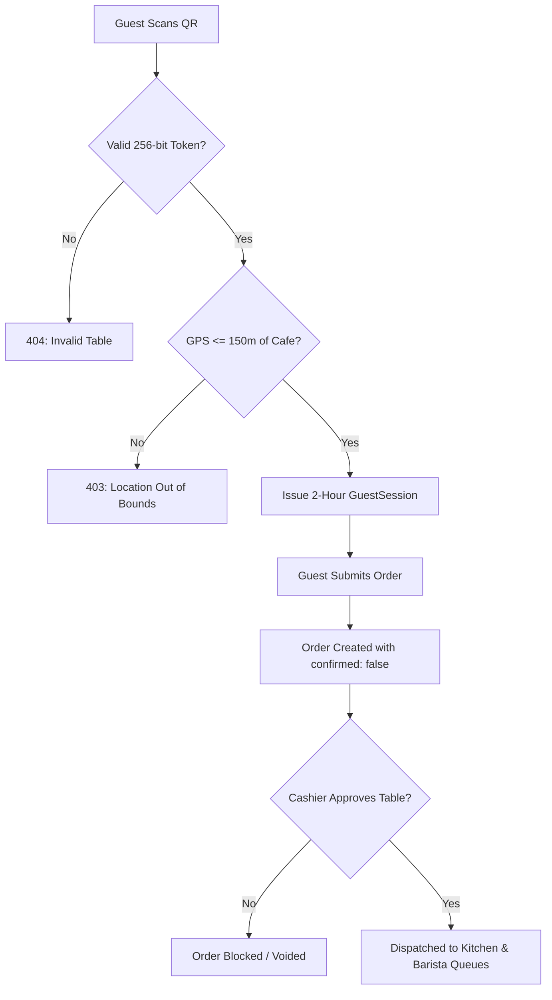

# Zoom RMS — Comprehensive Questions & Answers (Q&A) Guide
## *Defense, Technical Examination & Stakeholder Q&A Reference*

---

```
   ___        _   _    _       ____        __                     
  / _ \      | \ | |  / \     |  _ \  ___ / _| ___ _ __  ___  ___ 
 | | | |_____|  \| | / _ \    | | | |/ _ \ |_ / _ \ '_ \/ __|/ _ \
 | |_| |_____| |\  |/ ___ \   | |_| |  __/  _|  __/ | | \__ \  __/
  \__\_\     |_| \_/_/   \_\  |____/ \___|_|  \___|_| |_|___/\___|
                                                                  
      Master Reference Guide for Academic Defense & Technical Inquiries
```

> **Target Audience:** Academic Defense Committees, Thesis Advisors, Technical Interviewers, Project Evaluators, and Restaurant General Managers  
> **Repository:** `neang214/zoom-rms`  
> **Author/Maintainer:** Zoom RMS Development Team  
> **Format:** Categorized Q&A with Executive Answers, In-Depth Engineering Evidence, Code References, and Practical Rationale.

---

## 📑 Table of Contents

1. [Category 1: Project Overview, Scope & Motivation](#category-1-project-overview-scope--motivation)
2. [Category 2: System Architecture & Tech Stack Justification](#category-2-system-architecture--tech-stack-justification)
3. [Category 3: Security, Anti-Prank & Geofencing Shield](#category-3-security-anti-prank--geofencing-shield)
4. [Category 4: Database Design, Concurrency & Transaction Integrity](#category-4-database-design-concurrency--transaction-integrity)
5. [Category 5: Real-Time WebSocket Infrastructure & Audio Alerts](#category-5-real-time-websocket-infrastructure--audio-alerts)
6. [Category 6: Operational Workflows: POS, KDS, BDS & Waiter Mobility](#category-6-operational-workflows-pos-kds-bds--waiter-mobility)
7. [Category 7: Payments, Invoicing & Bakong KHQR Integration](#category-7-payments-invoicing--bakong-khqr-integration)
8. [Category 8: Inventory Management, Purchase Orders & Telegram Bot](#category-8-inventory-management-purchase-orders--telegram-bot)
9. [Category 9: Bilingual Localization (i18n) & User Experience](#category-9-bilingual-localization-i18n--user-experience)
10. [Category 10: Economics, Deployment & Future Scalability](#category-10-economics-deployment--future-scalability)

---

## Category 1: Project Overview, Scope & Motivation

### Q1.1: What is Zoom RMS, and what specific problem does it solve in the hospitality industry?
**Executive Answer:**  
Zoom RMS is an all-in-one, real-time Restaurant Management System designed for high-volume cafes and dining venues (inspired by Zoom Garden Café & Wine). It bridges the disconnect between guest ordering, cashier verification, kitchen preparation, beverage dispensing, and national digital payments (Bakong KHQR).

**In-Depth Engineering & Operational Detail:**  
Traditional restaurants suffer from:
1. **Order Latency & Labor Costs:** Waiters spend up to 70% of their shift shuttling paper slips between tables, cash registers, and kitchen counters.
2. **Order Inaccuracy:** Illegible handwriting and missed verbal dietary modifications (e.g., peanut allergies, sugar preferences) lead to returned dishes and lost revenue.
3. **Prank QR Submissions:** Off-the-shelf QR ordering solutions are vulnerable to remote or ghost orders placed by individuals outside the restaurant.
4. **Payment Inefficiencies:** In Cambodia, handling dual-currency cash (USD and Khmer Riel) creates bottlenecks during peak hours due to coin/change shortages.

Zoom RMS unifies these touchpoints into a reactive, synchronized web ecosystem where guests order autonomously from their phones, orders are cryptographically and geographically validated, staff are synchronized via WebSockets, and settlement is completed digitally via NBC Bakong KHQR.

---

### Q1.2: Who are the primary system actors, and what roles are supported?
**Executive Answer:**  
Zoom RMS supports six distinct user personas: **Guests** (unauthenticated/session-authenticated diners) and five staff roles governed by Role-Based Access Control (**RBAC**): `admin`, `cashier`, `kitchen`, `barista`, and `server`.

**Role Matrix:**
- **Guest (Customer):** Scans table QR code, browses bilingual menu, customizes items, places orders, and monitors real-time preparation status.
- **Cashier:** Oversees dining room floor layout, approves unconfirmed guest orders, handles manual walk-in tickets, prints receipts, and processes payments (Bakong KHQR, Cash, Card).
- **Kitchen (Chef):** Operates Kitchen Display System (KDS), views incoming food tickets (`type = 'food'`), advances status (`Pending` → `Preparing` → `Ready`), and reads cooking notes.
- **Barista:** Operates Barista Display System (BDS), views drink tickets (`type = 'drink'`), advances status, and adjusts sweetness/ice customizations.
- **Server (Waiter):** Uses a mobile handheld view (`ServerOrders.jsx`), receives instant notifications when dishes are marked `Ready`, delivers items to tables, and confirms status (`Ready` → `Served`).
- **Admin (Manager):** Full system governance: menu catalog, user accounts, dining table QR generation, inventory thresholds, supplier purchase orders, and business intelligence reports.

---

### Q1.3: What distinguishes Zoom RMS from off-the-shelf POS software like Toast or Square?
**Executive Answer:**  
Zoom RMS is purpose-built for the Cambodian and Southeast Asian restaurant landscape. Unlike Western SaaS solutions, it provides:
1. **Native Bakong KHQR:** Direct EMVCo-compliant QR generation for both USD and Khmer Riel (KHR) with automatic exchange rate conversion.
2. **Anti-Prank Geofencing:** Client GPS validation using the Haversine formula to prevent fake orders placed outside the restaurant perimeter.
3. **Dedicated Station Queues (KDS & BDS):** Automatic category-based separation between hot culinary dishes and handcrafted beverages.
4. **Zero Recurring SaaS Licensing Fees:** Self-hostable, lightweight open-source architecture built with modern Node.js, Express, and PostgreSQL.
5. **Integrated Telegram Bot:** Instant operational notifications (low-stock warnings, raw material usage) sent directly to manager mobile devices in Khmer.

---

## Category 2: System Architecture & Tech Stack Justification

### Q2.1: Why was Node.js and Express 5 chosen for the backend instead of NestJS, Spring Boot, or Django?
**Executive Answer:**  
Express 5 with ES Modules provides maximum asynchronous I/O throughput, minimal runtime overhead, and native promise rejection handling. It integrates seamlessly with Socket.io for low-latency WebSocket broadcasting.

**Technical Rationale:**
- **Async/Await Native Pipeline:** Express 5 natively handles rejected promises in route handlers, eliminating the need for boilerplate `asyncHandler` wrappers.
- **Lightweight Monolith / Micro-service Ready:** Because the domain modules (`orders`, `menuItems`, `payments`, `stock`) are decoupled, the architecture maintains high cohesion without the heavy cognitive overhead of NestJS dependency injection decorators.
- **Unified JavaScript/TypeScript Ecosystem:** Shared data models, validation concepts, and socket event names between the React frontend and Express backend reduce context switching.

---

### Q2.2: Why did you choose Prisma ORM over raw SQL queries or TypeORM?
**Executive Answer:**  
Prisma ORM 6 delivers compile-time type safety, automated migration management, an intuitive declarative schema syntax, and protection against SQL injection attacks, while still permitting raw SQL queries for complex transactional operations.

**Technical Reference in Code:**
- **Declarative Relational Modeling:** Relationships like `Order 1:N OrderItem` and `MenuCategory 1:N MenuItem` are explicitly defined in [schema.prisma](file:///home/itachi/Downloads/RMS/backend/prisma/schema.prisma).
- **Direct Raw SQL for Concurrency:** When precise PostgreSQL locking is required, Prisma allows raw execution:
  ```javascript
  await tx.$executeRaw`SELECT pg_advisory_xact_lock(${table.table_id})`;
  ```
- **Connection Optimization:** Prisma connects cleanly to Neon Serverless PostgreSQL with built-in connection pooling and keepalive timeouts.

---

### Q2.3: Why React 19 and Vite 8 for the frontend instead of Next.js?
**Executive Answer:**  
Zoom RMS operates as an interactive, real-time Single Page Application (SPA) across internal terminal devices (Kitchen iPads, Cashier touchscreens, Server phones). A Vite-powered React 19 SPA provides instant client-side state transitions, zero server-side rendering latency, and straightforward static file deployment.

**Engineering Highlights:**
- **Zero SSR Overhead:** Kitchen displays and cashier terminals stay active for 12+ hours continuously. Static SPA bundling with WebSocket event listeners eliminates unnecessary SSR round-trips.
- **Vite 8 Build Speeds:** Sub-second Hot Module Replacement (HMR) and optimized Rollup tree-shaking keep the frontend payload under 300 KB gzipped.
- **Tailwind CSS v4:** Zero-runtime styling engine with native CSS variable color tokens for instant dark/light theme switching.

---

## Category 3: Security, Anti-Prank & Geofencing Shield

### Q3.1: How does Zoom RMS solve the "QR Code Prank Order" vulnerability?
**Executive Answer:**  
Zoom RMS employs a **4-Layer Defense Shield**:
1. **Cryptographic Unguessable QR Tokens** (No sequential table IDs in URLs).
2. **GPS Geofencing (150m Radius)** using the Haversine formula.
3. **Hashed Expiring Guest Sessions** in PostgreSQL.
4. **Cashier POS Confirmation Gate** before any ticket enters the kitchen.



---

### Q3.2: How does the GPS Geofencing verification algorithm work mathematically?
**Executive Answer:**  
The server validates client coordinates against the café's fixed location (`CAFE_LAT`, `CAFE_LNG`) using the **Haversine Formula** implemented in [geo.js](file:///home/itachi/Downloads/RMS/backend/src/utils/geo.js).

**Mathematical Formulation:**
$$\Delta\text{lat} = \text{lat}_2 - \text{lat}_1, \quad \Delta\text{lon} = \text{lon}_2 - \text{lon}_1$$
$$a = \sin^2\left(\frac{\Delta\text{lat}}{2}\right) + \cos(\text{lat}_1)\cos(\text{lat}_2)\sin^2\left(\frac{\Delta\text{lon}}{2}\right)$$
$$c = 2 \cdot \text{atan2}\left(\sqrt{a}, \sqrt{1 - a}\right)$$
$$d = R \cdot c \quad (\text{where } R = 6,371,000 \text{ meters})$$

If $d > 150 \text{ meters}$ (or `MAX_ORDER_DISTANCE_M`), the backend immediately rejects order submission:
```json
{
  "status": 403,
  "message": "You must be at the café to place an order."
}
```

---

### Q3.3: How does the cryptographic QR token and guest session mechanism prevent URL tampering?
**Executive Answer:**  
Instead of exposing predictable sequential IDs (like `/order?table=5`), each table record in the database holds a cryptographically random 256-bit hex token (`qr_token`):
```sql
qr_token VARCHAR(64) UNIQUE NOT NULL
```
When a guest scans the QR card, the frontend calls `/api/guest-sessions` passing the `qr_token`. The server verifies the token and generates a temporary `GuestSession`:
1. Generates 32 bytes of secure entropy (`crypto.randomBytes(32).toString('hex')`).
2. Computes the SHA-256 hash of this raw token: `token_hash = sha256(rawToken)`.
3. Stores only `token_hash` in PostgreSQL with an expiration timestamp (`expires_at = now() + 2 hours`).
4. Returns the raw token to the guest mobile client.

On every subsequent order request, the client sends this bearer token. The server resolves the `table_id` strictly from the verified session in database memory. A malicious user cannot spoof another table because they cannot guess or forge a 256-bit cryptographic hash.

---

### Q3.4: How is staff authentication and authorization secured?
**Executive Answer:**  
Staff logins (`admin`, `cashier`, `barista`, `kitchen`, `server`) use **Bcrypt password hashing** (salt rounds = 10) and **JSON Web Tokens (JWT)** delivered via secure HTTP-Only cookies.

**Security Controls:**
- **No Token in LocalStorage:** Storing JWTs in HTTP-only cookies mitigates Cross-Site Scripting (XSS) token theft.
- **Middleware Role Gating (`checkRole`):** Routes are guarded by `authenticate` and `authorizeRoles([...roles])`. If a `barista` attempts to call administrative revenue routes (`/api/analytics`), the server returns `403 Forbidden`.

---

## Category 4: Database Design, Concurrency & Transaction Integrity

### Q4.1: What happens if two customers (or a customer and cashier) place an order on the same table at the exact same millisecond?
**Executive Answer:**  
Zoom RMS eliminates race conditions using PostgreSQL transactional advisory locks: `pg_advisory_xact_lock(table_id)` inside a Prisma interactive transaction.

**Code Proof in [order.controller.js](file:///home/itachi/Downloads/RMS/backend/src/modules/orders/order.controller.js):**
```javascript
await prisma.$transaction(async (tx) => {
  // Acquire transactional advisory lock scoped to this specific table ID
  await tx.$executeRaw`SELECT pg_advisory_xact_lock(${table.table_id})`;

  const existingOrder = await tx.order.findFirst({
    where: {
      table_id: table.table_id,
      status: { not: "Paid" },
      payments: { none: { status: "Completed" } },
    },
  });

  if (existingOrder) {
    const err = new Error("TABLE_HAS_ACTIVE_ORDER");
    err.order_id = existingOrder.order_id;
    throw err;
  }

  // Safe to create new order
  return await tx.order.create({ ... });
});
```
**Why this works:**  
The first request acquires the lock and creates the order. The second concurrent request is queued at the lock boundary; once it enters, it immediately detects `existingOrder` and is rejected with `TABLE_HAS_ACTIVE_ORDER` without corrupting table state.

---

### Q4.2: How is the database schema structured to separate order-level notes from item-level notes?
**Executive Answer:**  
Zoom RMS maintains two distinct note attributes:
1. **`Order.note` (Table-Level Note):** Attached to the entire dining party (e.g., *"Table celebrating anniversary"*, *"Please bring extra napkins"*).
2. **`OrderItem.note` (Per-Item Customization Note):** Attached directly to a specific dish or beverage line item (e.g., *"no onions"*, *"dairy allergy"*, *"less sweet 50%"*).

**Operational Benefit:**  
When the order is split between kitchen and barista queues, chefs only see the relevant dietary note for the steak, while the barista sees the sweetness note for the macchiato, avoiding confusing whole-order memos.

---

### Q4.3: Why does Zoom RMS use soft-status transitions instead of hard-deleting completed orders?
**Executive Answer:**  
Hard-deleting order records would destroy financial audit trails, tax compliance data, inventory depletion logs, and historical business intelligence.  
Instead, orders transition through a strictly defined state machine:
$$\text{Pending} \longrightarrow \text{Preparing} \longrightarrow \text{Served} \longrightarrow \text{Paid}$$
Tables remain linked to historical orders via foreign keys (`Table.orders`), enabling historical reporting on table occupancy, average dining duration, and revenue per table.

---

## Category 5: Real-Time WebSocket Infrastructure & Audio Alerts

### Q5.1: How are Socket.io rooms partitioned to prevent network broadcast flooding?
**Executive Answer:**  
Rather than broadcasting every event to all connected clients, Zoom RMS partitions connections into targeted **Role Rooms** and **Table Rooms** in [sockets/index.js](file:///home/itachi/Downloads/RMS/backend/src/sockets/index.js).

**Room Partitioning Topology:**
- `role:kitchen` — Receives only new food dish events (`order:new`) and food note changes.
- `role:barista` — Receives only beverage events and drink preparation notifications.
- `role:cashier` — Receives unconfirmed guest orders, bill requests, and payment updates.
- `role:server`  — Receives pickup alerts when items are marked `Ready`.
- `table:${table_id}` — Isolated guest room; guests receive status updates only for their own table.

---

### Q5.2: How do the Kitchen and Barista stations alert staff with audio without being blocked by browser autoplay policies?
**Executive Answer:**  
Modern browsers block unprompted audio playback. Zoom RMS utilizes the **Web Audio API** synthesized oscillator chime:
1. When staff open the KDS or BDS page, their initial interaction (tapping "Full Screen", "Start Shift", or touching the display) unlocks the browser's `AudioContext`.
2. When a Socket.io event (`order:new` or `order_item:note_changed`) fires, the application synthesizes a dual-tone sine wave frequency (e.g., 587 Hz to 880 Hz) using `audioCtx.createOscillator()` and `audioCtx.createGain()`.
3. This creates a crisp, clear chime without relying on external `.mp3` file assets that could fail to load or be blocked by browser media restrictions.

---

### Q5.3: How are daily sequential Queue Numbers calculated?
**Executive Answer:**  
Queue numbers reset daily at midnight (`00:00:00.000Z UTC`) to provide friendly ticket numbers (`#1`, `#2`, `#3`...) for guests and staff.  
Implemented in [queueNumber.js](file:///home/itachi/Downloads/RMS/backend/src/utils/queueNumber.js):
```javascript
export async function getQueueNumber(order) {
  const dateStr = new Date(order.order_date).toISOString().split("T")[0];
  const dayStart = new Date(`${dateStr}T00:00:00.000Z`);

  const countBefore = await prisma.order.count({
    where: {
      order_date: { gte: dayStart, lt: order.order_date },
    },
  });

  return countBefore + 1;
}
```

---

## Category 6: Operational Workflows: POS, KDS, BDS & Waiter Mobility

### Q6.1: What is the exact workflow of the "Cashier Confirmation Gate"?
**Executive Answer:**  
The Cashier Confirmation Gate is the primary human verification barrier:
1. When a guest submits an order via mobile QR, `channel = "guest"`, the order is created with `confirmed = false`.
2. The order is emitted via Socket.io **only** to `role:cashier`, `role:server`, and `role:admin`. It is **withheld** from the kitchen and barista.
3. The order appears in the cashier's "Unconfirmed Orders" panel with a blinking alert.
4. The cashier checks Table #04. Upon seeing real customers seated, the cashier clicks **Approve**.
5. The backend sets `confirmed = true` and dispatches:
   - Food items to `role:kitchen`
   - Drink items to `role:barista`
6. If the table is empty or the order is recognized as accidental, the cashier voids it immediately before any food ingredients are wasted.

---

### Q6.2: How does the system automatically update order status when items are completed?
**Executive Answer:**  
In [orderItem.controller.js](file:///home/itachi/Downloads/RMS/backend/src/modules/orderItems/orderItem.controller.js), whenever a chef or barista marks an individual item as `Ready`:
1. The server checks the status of all other sibling items belonging to that same `order_id`:
   ```javascript
   const allItems = await prisma.orderItem.findMany({
     where: { order_id: orderItem.order_id },
     select: { status: true },
   });
   const allReady = allItems.every((item) => item.status === "Ready");
   ```
2. If `allReady === true`, the master `Order.status` automatically advances to `Served`.
3. Sockets emit `order:status_changed` to the cashier, server, and guest table screen simultaneously.

---

### Q6.3: Can a guest edit their order or customize items after submitting?
**Executive Answer:**  
Yes, but with strict state guards:
- **Party Size & Order Notes:** Guests can edit `party_size` and whole-order notes **only while** `order.confirmed === false`. Once the cashier confirms the order, edits are blocked (`403 Forbidden`).
- **Item Customizations:** An individual item's notes can be updated or the item deleted **only while** `orderItem.status === "Pending"`. Once a chef clicks `Preparing`, the item is locked to prevent cooks from prepping altered recipes mid-cook.

---

## Category 7: Payments, Invoicing & Bakong KHQR Integration

### Q7.1: How does Zoom RMS integrate the National Bank of Cambodia’s Bakong KHQR standard?
**Executive Answer:**  
Zoom RMS implements the official `bakong-khqr` SDK to generate dynamic, EMVCo-compliant QR codes encoded with merchant credentials, bill identifiers, expiration timestamps, and currency specifications.

**Implementation Flow in [khqr.controller.js](file:///home/itachi/Downloads/RMS/backend/src/modules/payments/khqr.controller.js):**
1. Cashier initiates checkout for an active order.
2. Backend computes order total in USD or converts to Khmer Riel:
   $$\text{Amount (KHR)} = \text{Round}\left(\text{Total USD} \times 4100\right)$$
3. Backend initializes `IndividualInfo` with Merchant Account ID, Merchant Name (`Zoom Garden Cafe`), City (`Phnom Penh`), Bill Number, Amount, and Currency code.
4. Generates standard KHQR string and cryptographic **MD5 transaction checksum**.
5. Returns QR string to frontend, where it renders as an interactive QR payment modal with a 10-minute auto-expiry countdown.

---

### Q7.2: How is Bakong payment completion verified without requiring manual cashier confirmation?
**Executive Answer:**  
When the customer scans the QR code with their mobile banking app (e.g., ABA Mobile, Acleda, Wing, Sathapana, Bakong App) and confirms transfer:
1. The frontend POS polls `/api/payments/khqr/check/:md5?order_id=...` every 3 seconds (or receives a webhook callback).
2. The backend queries Bakong Open API using the transaction MD5 hash.
3. Upon receiving successful transaction confirmation from Bakong:
   - Creates a new record in `payments` (`status: "Completed"`, `method: "Bakong KHQR"`).
   - Updates `Order.status` to `Paid`.
   - Updates `Table.is_available` to `true`.
   - Emits `order:paid` to all terminals and resets floor layout.

---

### Q7.3: How does the system handle mixed cash and dual-currency payments?
**Executive Answer:**  
The Cashier Payment Dialog supports:
- **Cash USD and KHR Calculator:** Calculates exact change in both USD and Khmer Riel using the standard 4,100 KHR/USD rate.
- **Printed Tax Receipt / Bill:** Formatted printable receipt containing:
  - Restaurant Header (`Zoom Garden Café & Wine`)
  - Table Number & Daily Queue Number
  - Itemized dish breakdown with unit prices
  - Subtotal in USD and KHR
  - Cashier staff username and transaction timestamp.

---

## Category 8: Inventory Management, Purchase Orders & Telegram Bot

### Q8.1: How does Zoom RMS handle raw ingredient depletion and low-stock threshold alerts?
**Executive Answer:**  
Zoom RMS tracks raw ingredients in the `stock` table, complete with custom measurement units (`kg`, `liter`, `can`, `bottle`) and a minimum safety threshold (`min_level`).

**Workflow:**
1. When kitchen/barista staff fulfill orders or perform end-of-shift reconciliation, ingredient quantities are decremented.
2. If `stock.quantity <= stock.min_level`, the system sets an alert flag in the admin dashboard and triggers an automated **Telegram alert** to management.

---

### Q8.2: How does the Telegram Bot notification service function?
**Executive Answer:**  
The backend utilizes direct HTTPS calls to the official Telegram Bot API via [telegram.js](file:///home/itachi/Downloads/RMS/backend/src/utils/telegram.js) using native Node.js `https.request` with IPv4 resolution.

**Alert Types Dispatched in Khmer:**
1. **Low Stock Notification (`lowStockMessage`):**
   ```html
   ⚠️ <b>ជូនដំណឹងស្តុកទំនិញស្ទើរអស់</b> — Zoom Garden Café &amp; Wine
   <b>Arabica Coffee Beans</b> ស្ទើរតែអស់ហើយ។
   បច្ចុប្បន្ន៖ <b>4.20 kg</b>
   កម្រិតអប្បបរមា៖ <b>5.00 kg</b>
   សូមបន្ថែមស្តុកទំនិញជាបន្ទាន់។
   ```
2. **Staff Raw Stock Usage (`stockUsedMessage`):**
   Notifies managers when baristas or kitchen staff draw materials from central storage.

---

### Q8.3: How do Purchase Orders (PO) automatically replenish inventory?
**Executive Answer:**  
Purchase Orders follow a strict three-state lifecycle:
$$\text{Pending} \longrightarrow \text{Ordered} \longrightarrow \text{Received}$$
In [stockOrder.controller.js](file:///home/itachi/Downloads/RMS/backend/src/modules/stockOrders/stockOrder.controller.js), when an administrator updates a PO to `Received`:
1. The server wraps the operation in a transaction.
2. It fetches the PO's linked `stock_id` and `quantity`.
3. It increments `stock.quantity` by the received invoice amount:
   ```javascript
   await tx.stock.update({
     where: { stock_id: po.stock_id },
     data: { quantity: { increment: po.quantity } },
   });
   ```
4. This guarantees that stock quantities are always synchronized with actual supplier invoices without manual double-entry.

---

## Category 9: Bilingual Localization (i18n) & User Experience

### Q9.1: How is bilingual localization (Khmer & English) implemented across the application?
**Executive Answer:**  
Zoom RMS provides end-to-end bilingual support across both user interface labels and database catalog items:
1. **UI Dictionary:** Over 33,000 bytes of structured translation keys in `frontend/src/i18n/translations.js` wrapped in a React `LanguageContext`.
2. **Database Fallback:** The `menu_items` table features dual-column naming:
   - `item_name` (English name, e.g. *"Beef Lok Lak"*)
   - `item_name_km` (Khmer name, e.g. *"បាយឡុកឡាក់សាច់គោ"*)
3. **Graceful Fallback:** If `item_name_km` is null or empty, the frontend cleanly falls back to `item_name` without throwing UI layout errors.

---

### Q9.2: How does the UI handle complex Khmer typography and font rendering?
**Executive Answer:**  
Khmer Unicode script requires precise line-height, sub-script character rendering, and font baseline alignment.  
- Zoom RMS integrates modern typography (e.g., *Kantumruy Pro* or *Battambang* web fonts) via Tailwind CSS tokens.
- UI elements feature dynamic padding and flexible vertical bounds so that Khmer subscript consonants and vowel diacritics are never visually clipped on mobile or tablet screens.

---

## Category 10: Economics, Deployment & Future Scalability

### Q10.1: How was the project cost of $1,350 calculated in Chapter 5 of the project report?
**Executive Answer:**  
As documented in `chart.md` (Chapter 5 Economic Analysis), the budget was estimated using a balanced modular breakdown covering **22 granular development modules**:
- User Management & RBAC ($45) + Auth Engine ($40) = **$85**
- Table Registry ($45) + 256-bit QR Crypto Engine ($50) = **$95**
- Anti-Prank Geofencing & Bot Shield = **$65**
- Menu & Category Catalog ($110) + Media Pipeline ($40) = **$150**
- Guest Ordering Portal ($80) + Cashier POS Gate ($90) = **$170**
- Kitchen KDS ($75) + Barista BDS ($70) + Waiter Module ($65) = **$210**
- WebSocket Engine ($55) + Bakong KHQR ($95) + POS Billing ($55) = **$205**
- Telegram Bot ($45) + Inventory Units ($70) + Suppliers & POs ($70) = **$185**
- Bilingual Engine ($55) + BI Analytics ($60) + DevOps/Docker ($70) = **$185**
- **Grand Total: $1,350 USD**.

This realistic economic model reflects real-world commercial software development hours in Cambodia's tech sector.

---

### Q10.2: How is Zoom RMS deployed to production?
**Executive Answer:**  
Zoom RMS utilizes containerized and serverless cloud architecture:
1. **Database:** Hosted on **Neon Serverless PostgreSQL** with connection pooling.
2. **Backend API & WebSockets:** Packaged into a multi-stage Docker container (`node:20-bookworm-slim`) and deployed on **Fly.io** or a Virtual Private Server (VPS) with port 8080 exposed.
3. **Frontend SPA:** Compiled with Vite (`npm run build`) and deployed to global edge CDNs (such as **Vercel** or **Cloudflare Pages**) with automated HTTPS certification and zero cold-starts.

---

### Q10.3: What architectural changes would be required to scale Zoom RMS to a 50-branch restaurant chain?
**Executive Answer:**  
The system was designed with modular domain boundaries, making multi-tenant expansion straightforward:
1. **Multi-Tenancy Schema Migration:** Introduce a `branches` table (`branch_id`, `branch_name`, `lat`, `long`) and add `branch_id` foreign keys to `tables`, `orders`, `stock`, and `users`.
2. **Redis Pub/Sub Socket Adapter:** Replace in-memory Socket.io message broadcasting with `@socket.io/redis-adapter` so multiple horizontally scaled backend server instances can broadcast to each other.
3. **Database Sharding or Row-Level Security (RLS):** Partition high-volume `orders` and `order_items` tables by `branch_id` and date range.
4. **Centralized Supply Chain Hub:** Allow branch managers to create Purchase Orders fulfilled directly by a central corporate warehouse.

---

## 🎯 Summary Defense Takeaway
Zoom RMS represents a robust, practical, and technically accomplished full-stack software engineering project. It solves authentic hospitality challenges in Cambodia by harmonizing **cryptographic security**, **real-time bi-directional messaging**, **national mobile payments**, and **automated supply chain intelligence** into a performant, production-ready system.
